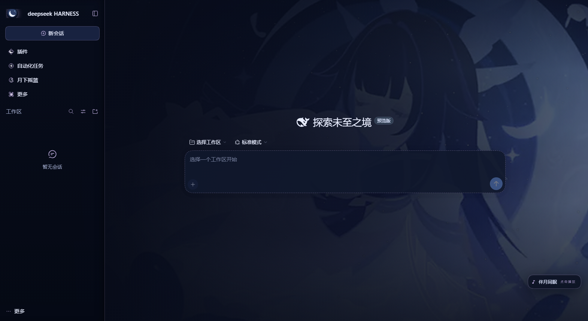
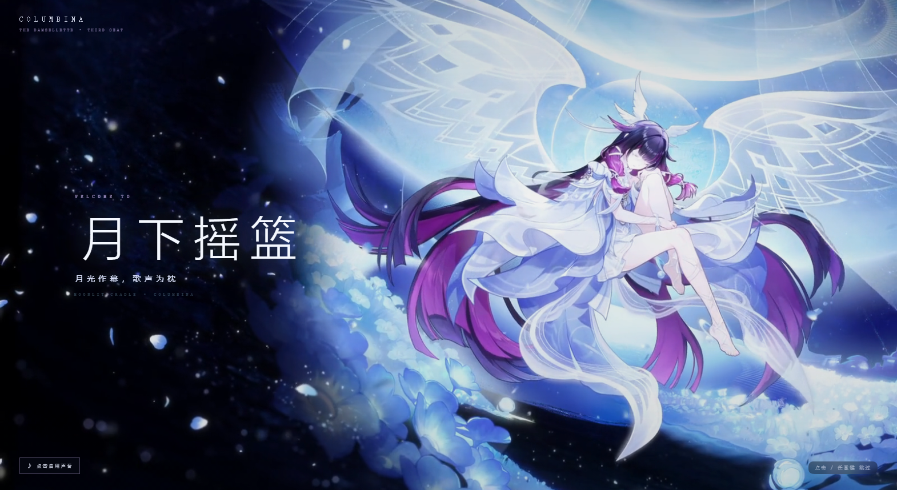

# 哥伦比娅 · 月下摇篮

> 「少女」的月夜与摇篮曲，做成 **DeepSeek Harness Web GUI** 可以直接安装的深色主题：月下立绘、玻璃侧栏、电影式开屏、三首可切换的摇篮曲，以及一个可开关的哥伦比娅人格。

当前版本：**1.1.3**。这一版把哥伦比娅语音做成了原声切片库：C′ 手写意图序列 + D 低置信度检索，不合成新词；1.1.3 用 ASR 校验了模板与检索库，修掉了 ack/farewell 等错配。




## 这是什么

一个从零写的 DSH 主题包，不是把别处的 CSS 搬过来：配色走 DSH 自己的 `--dsw-*` 设计变量，开屏与播放器是声明在 `dsh.client` 里的客户端插件，配乐、图标、开屏影片全部由仓库里的脚本从原始素材生成。

仓库里有四个包：

| 目录 | 作用 |
| --- | --- |
| `dsh-theme-columbina/` | 主题本体：月夜配色、月下立绘、玻璃侧栏、电影式开屏、摇篮曲播放器 |
| `dsh-plugin-columbina/` | 可选的左侧栏「月下摇篮」入口：状态、三首曲子的播放面板、语气开关、语音状态/试听、重播开屏 |
| `dsh-plugin-columbina-persona/` | 对话语气：可开关的系统提示段，让回复带上「少女」的口吻 |
| `dsh-plugin-columbina-voice/` | 原声语音：480 段完整切片 + C′ 意图序列 + D 相似度兜底，不调用 TTS |

## 特性

- **月夜配色**：深夜蓝画布 `#070b18`、月光白正文 `#e9eeff`、银紫品牌色 `#cbb6ee`、冰蓝链接 `#9fd8f5`、只出现在错误状态里的玫瑰色 `#e39ac0`。
- **月下立绘**：背景铺满窗口画布，左侧渐变压暗保证正文可读，右侧留给人物与月亮；整张图外面再罩一层均匀的夜纱，让画面当氛围而不是当海报。
- **玻璃侧栏**：半透明夜玻璃 + 银紫发丝描边 + 18px 背景模糊。
- **电影式开屏**：15 秒壁纸影片作底，一弯月牙里开出一扇圆窗，三句短词落下，9.15 秒圆窗涨满全屏；原创八音盒配乐，点击或任意键跳过，每个页面会话只播一次。
- **摇篮曲播放器**：右下角常驻的小月亮按钮，展开是「月之摇篮曲」面板——三首曲子任选、开关背景音乐、调音量；选择记在本地。
- **对话人格**：可开关的系统提示段，短句、省略号、偶尔用哼唱代替回答；命令、路径、代码、报错仍然精确。
- **原声语音**：右下角 ♪ 按钮；480 段原声切片，C′ 意图模板优先，D 相似度检索兜底；代码/命令/低置信度保持静默，只留文字。
- **月下摇篮里的语音控制**：状态、切换、试听都在左侧栏；切换会同步右下角 ♪ 的状态。
- **标题栏侧栏开关**：外壳自带的 Ctrl+B 按钮会压在月徽上，主题把它换成左上角一枚银紫小按钮（和桑多涅主题同位置），点击转发给外壳，`Ctrl+B` 照常可用。
- **深色专用**：启用期间钉住 `body[data-ds-dark-theme]`，禁用后立刻回到 DSH 原生外观。

## 开屏



不是 HUD，也不是进度条。整段只做一件事：让月亮把画面打开。

| 时间 | 画面 |
| --- | --- |
| 0–0.7s | 黑场，`COLUMBINA / THE DAMSELLETTE · THIRD SEAT` 浮出 |
| 0.7–1.9s | 一弯新月在人物所在的位置被逐笔描出 |
| 1.2–3.4s | 「今晚的月亮，很轻。」「轻得像一句没说完的话。」一句一句落下 |
| 3.4–8.6s | 月牙里开出一扇圆窗，壁纸影片在其中缓缓透出，边缘是一条细银环 |
| 8.6–9.15s | 呼吸停一拍；最后一句「那就先闭上眼吧…」淡出 |
| 9.15s | 圆窗涨满全屏：银白闪光、影片提亮、「月下摇篮」落在左侧 |
| 10.6s | 「月光作幕，歌声为枕」 |
| 11.8s | `MOONLIT CRADLE · COLUMBINA` |
| 15.1s | 整层淡出，交出工作界面 |

点击 / `Esc` / `Enter` / 空格跳过，22 秒硬兜底。地址带 `#opening` 可强制重播。

圆窗用的是加在 `<video>` 上的径向遮罩，不是容器的 `overflow` 圆角——后者在视频层被提升成合成层时会渲染成圆角方形（试过，真的会）。

### 开屏配乐

只有一首：**月茧**（`assets/opening-score.m4a`）。八音盒主奏 + 低音弦，9.15 秒那一记低频落点正好压住圆窗涨满的闪光，标题落下来时还剩一点余音。`tools/build-score.py` 用 numpy 从零合成，随代码以 MIT 发布。

## 主界面 BGM

三首《新月的摇篮曲》**随仓库分发**，放在 `dsh-theme-columbina/assets/bgm/`，由本机 Host 通过 `/theme-columbina/music/track?slug=<i|ii|iii>` 提供给播放器。

| # | 曲目 | 文件 |
| --- | --- | --- |
| Ⅰ | 新月的摇篮曲（其一）：伴月同眠 | `01-somnias-a-luna.mp3` |
| Ⅱ | 新月的摇篮曲（其二）：宵晖下的笑颜 | `02-lucens-ut-risus.mp3` |
| Ⅲ | 新月的摇篮曲（其三）：眉间落英 | `03-petala-ceciderunt.mp3` |

- 音频版权归 HOYO-MiX / 权利人，**不属于 MIT**；仓库只是把使用者提供的文件原样放进来，见 [ASSET-LICENSE.md](ASSET-LICENSE.md)；
- 只有 `lib/index.js` 里 `TRACKS` 白名单中的三个 slug 会被读取，不是通用文件接口；
- 文件名缺失或读不出时保持静音并显示「未找到」，不报错、不卡界面；
- 浏览器要求先有一次点击才允许出声：点右下角的小月亮或面板里的任意一首，就会直接开始播放。

## 安装

```powershell
pwsh -File .\install.ps1
```

装完**完整退出 DSH 再打开一次**：客户端插件声明（`dsh.client`）按包名缓存到进程结束，不重启只有配色和开屏的宿主半边生效，开屏与播放器不会挂上。

只装其中一部分：

```powershell
pwsh -File .\dsh-theme-columbina\install.ps1          # 主题
pwsh -File .\dsh-plugin-columbina\install.ps1         # 侧栏入口
pwsh -File .\dsh-plugin-columbina-persona\install.ps1 # 语气
pwsh -File .\dsh-plugin-columbina-voice\install.ps1   # 原声语音
```

安装脚本会：复制到 `%USERPROFILE%\.dsh\{themes,plugins}\...`、在 profile 的 `node_modules` 里建 junction、往 `cordis.patch.yml` 追加一条 `insert` row（先备份），并清理 `package.json` / patch 的 UTF-8 BOM（DSH 启动时对 BOM 是 fatal）。

> 如果你之前装过桑多涅主题，安装脚本会把它的三条 row 标成 `disabled: true`——两个主题都画布会互相遮，删掉那行即可切回。

### 验证

```text
http://127.0.0.1:<GUI端口>/theme-columbina/status
http://127.0.0.1:<GUI端口>/theme-columbina/music/deck
http://127.0.0.1:<GUI端口>/columbina-hub/status
http://127.0.0.1:<GUI端口>/columbina-persona/status
http://127.0.0.1:<GUI端口>/columbina-voice/status
```

`/theme-columbina/status` 返回 `theme: "columbina-lullaby"`、样式表命中次数，以及页面回传的实况（深色属性、框架、`centerCol`/`sidebarCol`、开屏、播放器、窗口尺寸）。

### 卸载

```powershell
pwsh -File .\uninstall.ps1           # 移除四条 row 和 junction，文件保留
pwsh -File .\uninstall.ps1 -Purge    # 连同 ~/.dsh 下的四个包一起删
```

## 自定义

| 想改什么 | 改哪里 |
| --- | --- |
| 颜色 | `dsh-theme-columbina/theme/theme.css` 第 1 节（palette） |
| 立绘位置 / 浓度 | `theme/theme.css` 第 2 节（`background-position` / 遮罩渐变） |
| 换一张底图 | 覆盖 `assets/background.webp`（16:9，建议 ≤ 2560×1440） |
| 只保留配色、不要立绘 | patch 条目加 `config: { art: false }` |
| 关掉音乐代理 | patch 条目加 `config: { music: false }` |
| 尊重系统浅色外观 | patch 条目加 `config: { forceDark: false }` |
| 临时关掉 | 给 patch 条目加 `disabled: true` |

CSS 与 JSON 资源带 `no-cache` + ETag，改完刷新页面（Ctrl+R）即可看到，不用重装。

## 结构

```text
.
├── README.md
├── LICENSE                     # 代码 MIT
├── ASSET-LICENSE.md            # 第三方素材权利说明
├── NOTICE.md
├── CREDITS.md                  # 配乐 / 美术 / 上游署名
├── SECURITY.md                 # 安全策略与密钥处理
├── install.ps1 / uninstall.ps1
├── docs/                       # 截图、配乐候选、发布检查清单
├── preview/                    # 配乐试听页与本地静态服务
├── tools/
│   ├── build-assets.py         # 从原始素材生成背景、开屏美术、图标
│   ├── build-score.py          # 合成开屏配乐（两套编曲）
│   ├── make-provenance.py      # 生成逐文件哈希与来源
│   ├── install-into-home.py    # 一次性安装到指定 DSH_HOME
│   └── build-release.py        # 生成 dist zip 与 SHA-256
├── dsh-theme-columbina/
│   ├── package.json            # DSH bundle + client 声明
│   ├── cordis.patch.yml
│   ├── lib/index.js            # 宿主半边：资源路由、Range、本地曲库、自检
│   ├── lib/client.js           # 浏览器半边：注入样式、钉深色、开屏、播放器
│   ├── theme/theme.css         # 全部视觉
│   ├── assets/                 # 背景、开屏影片/美术、原创配乐、图标与徽记
│   ├── tools/smoke.mjs         # 假 ctx 跑一遍宿主半边
│   ├── tools/audit-tokens.mjs  # 比对 token 名是否真实存在
│   └── install.ps1 / uninstall.ps1 / README.md / NOTICE.md / LICENSE ...
├── dsh-plugin-columbina/       # 侧栏入口（状态 + 摇篮曲面板 + 语气开关）
├── dsh-plugin-columbina-persona/  # 系统提示段 + POST /enabled
└── dsh-plugin-columbina-voice/  # 原声切片库 + C′ 意图 + D 检索
```

## 工作原理

DSH 桌面端的主窗口不是用 `http://127.0.0.1:<port>/` 加载的，而是走 `dsh-app://app/` 自定义协议；宿主在**启动时**采集一次 index 注入行，之后不再刷新。所以只做 index 注入，在桌面端会「装上了但没反应」。

- **宿主半边** `lib/index.js`：注册 `/theme-columbina/*` 静态资源路由（CSS、立绘、开屏影片、开屏配乐、本地摇篮曲、自检 beacon），并额外贡献 index 注入行（纯浏览器 `dsh web` 场景的首屏兜底）。
- **浏览器半边** `lib/client.js`：`dsh.client` 声明的客户端插件，随模块图进页面，挂载时注入样式表、把 `data-ds-dark-theme` 钉住、挂开屏和播放器。

### 几个踩出来的约束

1. **立绘必须画在画布上，不能画在框架上。** 桌面端窗口用 `dsh-app://app/` 加载，框架外层还套着 `display: contents` 的 provider；任何「找到框架元素再上色」的写法都会因为层级变化失效。现在 `html` 铺满立绘，`--dsw-alias-bg-base` 改成透明。
2. **`--dsw-specific-sidebar-fill` 不能是半透明以上。** Windows 自定义标题栏那条规则（`[data-windows-titlebar] .frame`）会用这个 token 把整个框架再刷一遍。
3. **样式表链接必须带版本号。** 桌面端把宿主响应通过自定义协议转发，会丢掉 `cache-control` / `etag`，浏览器于是永不回源校验。
4. **绝不在 React 的树里增删节点。** 侧栏图标全部用纯 CSS 覆盖（伪元素），早期用 `replaceChild` 换图标会让 React 下一次协调找不到节点。
5. **开屏样式必须内联。** 带 `data-plugin-css` 的 `<style>` 会被客户端内核当成插件样式回收。
6. **`[class*="composer"]` 会命中一整排容器**（`composerSeat` / `composerStack`），给它加背景会画出一条横贯窗口的色带——只改 border 和焦点环。
7. **媒体流不能被 `AbortSignal.timeout` 管到收完为止。** 浏览器暂停/切歌会中途断开 socket，上游流报错会冒成 uncaught exception 把宿主带走；现在只给「建连」计时，并给 `res`/`stream` 都挂了销毁回调。

## 兼容与排障

- 针对 DSH `0.2.1-rc.3` 验证。结构选择器只用了 `#root > div:first-child` 和 `[class*="centerCol"|"rightbarCol"|"sidebarCol"|"composer"]` 这类稳定后缀。
- 升级后立绘 / 图标消失：多半是 DSH 改了后缀或 token 名，改 `theme/theme.css` 对应选择器即可。
- DSH 起不来：检查 profile 的 `package.json` 和 `cordis.patch.yml` 是否有 UTF-8 BOM；安装脚本会自动清理。
- 侧栏入口没出现：先 `Ctrl+R`，再完整退出 DSH 重开。
- 播放器显示「未找到」：`assets/bgm/` 里的三个文件没被安装脚本带上，重新跑一次 `install.ps1`，或直接看 `/theme-columbina/music/deck` 的 `local` 字段。

## 素材、许可与声明

**代码 MIT，素材不是。**

- 本仓库新增的 DSH 移植代码（`lib/`、`theme/theme.css`、安装脚本、`tools/`、语气提示文本）：**MIT**，见 [LICENSE](LICENSE)。
- `dsh-theme-columbina/assets/` 里的角色图、开屏影片与衍生素材：**不属于 MIT**，来自你提供的插画与 Wallpaper Engine 创意工坊素材，权利归原权利人。
- 开屏配乐（月茧）：`tools/build-score.py` 用 numpy 从零合成，随代码以 MIT 发布。
- 主界面三首《新月的摇篮曲》：版权归 HOYO-MiX / 权利人所有，**不属于 MIT**；仓库按使用者提供的文件原样收录，若权利人要求会移除。
- 原声语音库：`dsh-plugin-columbina-voice/assets/clips/` 的 480 段切片来自使用者提供的全语音素材与 Bilibili 参考 `BV1fQzSBMEbs`（CV：杨梦露），权利归原权利人，**不属于 MIT**。
- 逐文件来源、SHA-256 与转换说明见 [dsh-theme-columbina/PROVENANCE.json](dsh-theme-columbina/PROVENANCE.json)，权利说明见 [ASSET-LICENSE.md](ASSET-LICENSE.md) 与 [NOTICE.md](NOTICE.md)。

非官方同人主题，与 HoYoverse / COGNOSPHERE、DeepSeek 均无隶属或背书关系。

## 安全与发布

- 仓库里不保存密钥；`.gitignore` 覆盖常见敏感文件名。发现密钥或漏洞请按 [SECURITY.md](SECURITY.md) 处理，不要在公开 Issue 里贴真实 Key。
- 发布前清单见 [docs/release-checklist.md](docs/release-checklist.md)：密钥扫描、素材权利、截图裁剪、发行包哈希都在里面。
- 发行包：`python tools/build-release.py` → `dist/dsh-theme-columbina-<version>.zip` 与 `SHA256SUMS-v<version>.txt`。

## English

A moonlit night-blue theme for the **DeepSeek Harness Web GUI**, built from scratch against DSH's own design tokens: character artwork on the canvas, a frosted sidebar, a 17-second cinematic opening (crescent window over the supplied film, original score), a three-track lullaby deck, a themed title-bar toggle, a toggleable Columbina persona, and an original-clip voice bank (C′ intent sequences + D retrieval, no TTS).

- Requires DSH `0.2.1-rc.3+`; install with `pwsh -File .\install.ps1`, then fully restart DSH.
- Code and the synthesized score are MIT. Character artwork, the opening film, the lullabies and the voice-bank clips are **not** MIT.
- Unofficial fan project; not affiliated with HoYoverse/COGNOSPHERE or DeepSeek.
